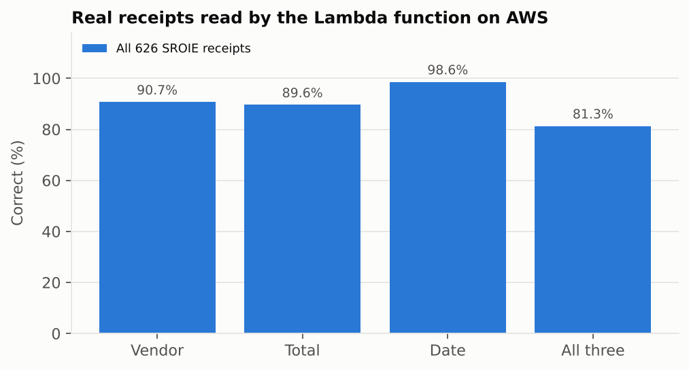
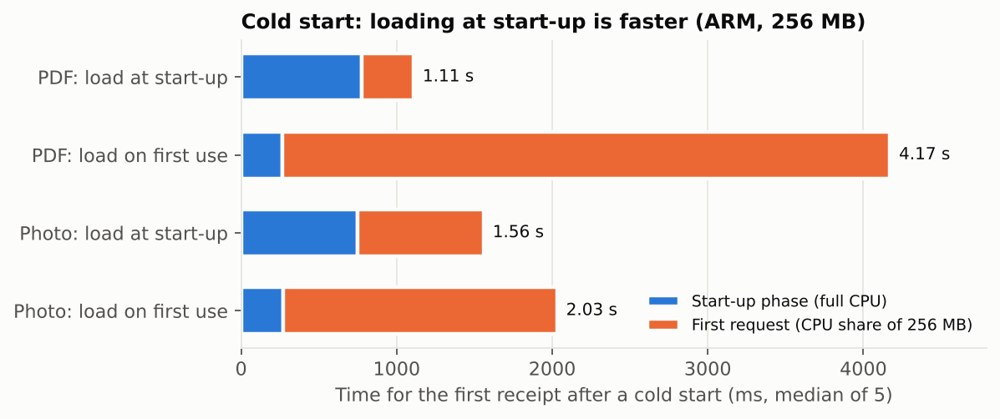
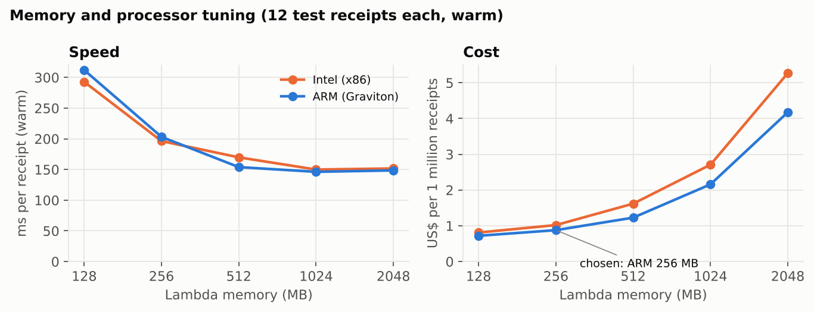
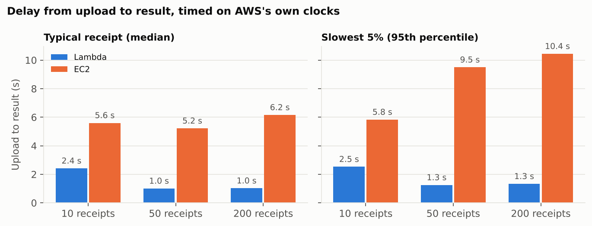
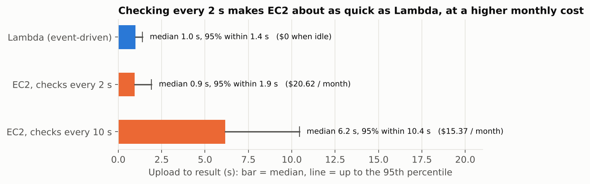
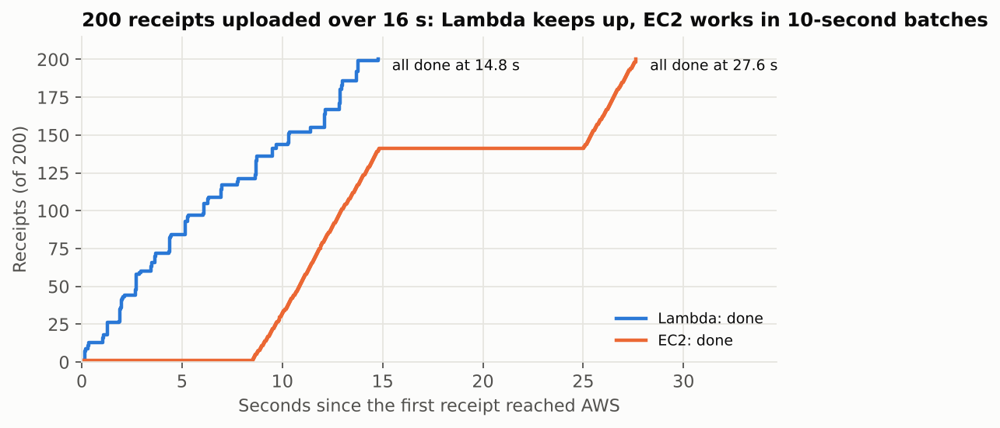

# Experiment results

Everything was measured on the live AWS account (region `ap-southeast-2`, Sydney) between 26 and 28 October 2026.
The raw data is in `results/`, and `python3 analyze.py --full exp-20261027-211243` rebuilds every chart and number
here from it.

| Experiment | Run used | Why this run |
| --- | --- | --- |
| Accuracy, all 626 receipts and 170 GST invoices | `exp-20261027-211243` | the full test set |
| First accuracy run, 40 receipts, and memory tuning | `exp-20261026-184235` | first full run |
| Cold start | `exp-20261026-191209` | after the start-up fix, on ARM |
| Delay, steady stream | `exp-20261027-145512` | delays timed on AWS's own clocks |
| True burst (200 at once) | `exp-20261026-193128` | the only run where the laptop uploaded fast enough to make a real burst |
| Accuracy after the total fix | `exp-20261027-154225` | 40 receipts, fixed code |
| EC2 checking every 2 s; long photos read in parallel | `exp-20261027-161506` | the fairness check and the final code |

## 1. Reading accuracy

Every number in this section was measured on AWS: each image was uploaded to S3, read by the Lambda function with
Amazon Rekognition, and the saved result compared with the dataset's answer key (run `exp-20261027-211243`,
`python3 experiments.py accuracy`). The datasets are listed in `DATASETS.md`.

**626 real scanned receipts (SROIE, Malaysian shop receipts):**

| | Correct | Count |
| --- | --- | --- |
| Vendor | 90.7% | 568 of 626 |
| Total | 89.6% | 561 of 626 |
| Date | 98.6% | 617 of 626 |
| **All three correct** | **81.3%** | 509 of 626 |

- 362 receipts (57.8%) had more than 100 words and needed the banded reading (3.3 Rekognition calls on average, at most 7).
- 55 receipts (8.8%) were saved as NEEDS_REVIEW; the other 571 as PROCESSED. None failed to save.
- Of the 117 receipts that were not fully right, 33 were flagged for review and 84 were saved as PROCESSED, mostly
  with a wrong vendor name. 65 totals were wrong: 28 flagged, **37 (5.9% of all receipts) not flagged**.
  22 fully correct receipts were flagged for review by mistake (3.5% of the correct ones).
- Some misses come from the dataset's answer key rather than the code (blank or truncated answers).
- **Time per receipt under this load:** median 2.7 s, 95th percentile 9.8 s, slowest 25.2 s (the Lambda limit is
  30 s). 40 receipts arrived at the same moment, so many were waiting for Rekognition at once; 28 receipts took
  more than 10 s. Single uploads are faster (section 4).

**What went wrong most often** (examples from `accuracy.csv`):
- **Vendor (58 receipts).** A name read from the wrong place (a cashier name, a shop name from the footer, a town),
  or only part of a long legal name.
- **Total (65).** A total not found (flagged for review), or a different number on the receipt taken instead.
- **Date (9).** No date found, or a misread digit (for example 2012 for 2017).

**Development runs on the first 40 receipts** (also on AWS), which led to the parser changes:

| Run | Vendor | Total | Date | All three |
| --- | --- | --- | --- | --- |
| First live run (`exp-20261026-184235`) | 87.5% | 85.0% | 97.5% | 80.0% |
| After the total sanity check (`exp-20261027-154225`) | 87.5% | 92.5% | 97.5% | 82.5% |

**What the parser does:**
- **Totals.** It scores every "total" line instead of taking the last one, ignores the tax summary table, and
  trusts "cash given minus change" because that is what was actually paid.
- **Vendors.** It prefers registered names (Sdn Bhd, Pvt Ltd), joins names that wrap onto two lines, and skips
  address lines and registration numbers.
- **Long receipts.** Rekognition reads at most 100 words per call and a total is usually printed last, so a
  long photo is cut into bands that are read in parallel.
- **Total sanity check.** A receipt goes to review when its total is below 90% of the subtotal, or below half of an
  item price, unless a discount or deposit explains it. A third check, "the total equals a tax amount", was tried
  and dropped: on the first 40 receipts it caught 2 wrong totals but flagged 17 correct ones.

**Long photos, read in parallel** (run `exp-20261027-161506`, the 40 receipts, one chunk at a time): accuracy
unchanged (82.5%), median processing time 5.3 s to **2.4 s**, average billed time 4.0 s to **2.2 s**.

**Indian GST invoices (170 images, all computer-generated):**

| | Result |
| --- | --- |
| Correct verdicts | 169 of 170 |
| Genuine invoices passed (100 originals and 10 re-shot copies) | 110 of 110 |
| Tampered invoices caught | 59 of 60 |
| Fields (vendor, total, date) all correct | 110 of 110 genuine |
| Duplicates caught (10 re-shot copies) | 10 of 10 |
| GSTIN read exactly (genuine) | 109 of 110 |
| False GST alarms on the 626 Malaysian receipts | 3 (0.5%) |

The 60 tampered invoices have six kinds of mistake, ten each: a wrong GSTIN check digit, a state code that does
not exist, CGST not equal to SGST, an inflated total, IGST charged together with CGST/SGST, and tax that does not
add up to the total.

- **The one tampered invoice that passed** had its GSTIN check character changed to one that matches an OCR-style
  repair of an ambiguous character (1 or I at the 13th place). It also passes with perfect text, so it is a
  limit of that repair rule, not of the OCR.
- **The 3 false alarms** are Malaysian receipts with a GST (tax) line that the checks read as an Indian GST invoice
  (`sroie-171`, `sroie-312`, `sroie-591`). They were saved as NEEDS_REVIEW, not as errors.

## 2. Cold start: the "optimisation" that made it slower

To speed up cold starts, the AWS clients and the PDF library were first changed to load on first use instead of
at start-up. Measuring it showed the opposite: it was **3.8 times slower** for a PDF. The same result appeared on
Intel (5.03 s vs 1.28 s) and on ARM.

| First receipt after a cold start (ARM, 256 MB, median of 5) | Start-up phase | First request | Total billed |
| --- | --- | --- | --- |
| PDF, load at start-up | 777 ms | 331 ms | **1,101 ms** |
| PDF, load on first use | 263 ms | 3,906 ms | **4,161 ms** |
| Photo, load at start-up | 749 ms | 808 ms | **1,562 ms** |
| Photo, load on first use | 270 ms | 1,760 ms | **2,030 ms** |

**Why:**
- The measurements show the start-up phase getting more CPU than a request gets at 256 MB.
- Moving about 500 ms of start-up work into the request made it take about 3.6 s longer, roughly 7 times slower.
  That matches 256 MB's share of a CPU (Lambda gives one full vCPU at 1,769 MB, so 256 MB gets about 1/7).
- Since 1 August 2025, start-up time is billed like request time, so the slower version also costs more.

The code now loads everything at start-up. `LAZY_INIT=1` exists only so this experiment can be repeated.

## 3. Memory and processor tuning

The 12 test receipts were run at each memory size on Intel (x86_64) and ARM (Graviton). Cost covers Lambda compute
plus requests, at list prices.

| Memory | Intel warm time | ARM warm time | Intel cost per 1M receipts | ARM cost per 1M receipts | Max memory used |
| --- | --- | --- | --- | --- | --- |
| 128 MB | 293 ms | 312 ms | $0.81 | $0.72 | 119 MB |
| **256 MB** | 196 ms | **203 ms** | $1.02 | **$0.88** | 151 MB |
| 512 MB | 170 ms | 154 ms | $1.62 | $1.23 | 151 MB |
| 1024 MB | 150 ms | 146 ms | $2.71 | $2.16 | 151 MB |
| 2048 MB | 152 ms | 149 ms | $5.27 | $4.18 | 151 MB |

Every configuration read all 12 receipts correctly.

**Chosen setting: ARM at 256 MB.** It is about 14% cheaper than Intel at the same speed.
- 128 MB is cheaper still, but used 119 of its 128 MB, too close to running out on a bigger photo.
- Above 1024 MB nothing gets faster. The work is mostly waiting on S3, DynamoDB and Rekognition, not on the CPU.

## 4. Delay from upload to result: Lambda vs EC2

**How delay was timed (AWS's own clocks only):**
- **Lambda:** from S3's upload-event timestamp (millisecond precision) to when the result was saved.
- **EC2:** from the upload time in S3's file listing, which has whole-second precision, so 0.5 s is added for
  rounding (accurate to ±0.5 s).

In this run the laptop's uploads were spread over 3 s (10 receipts), 75 s (50) and 138 s (200), so it shows a
steady stream rather than a burst.

| Receipts | Lambda median | Lambda 95th % | EC2 median | EC2 95th % |
| --- | --- | --- | --- | --- |
| 10 | 2.4 s | 2.5 s | 5.6 s | 5.8 s |
| 50 | 1.0 s | 1.3 s | 5.2 s | 9.5 s |
| 200 | 1.0 s | 1.3 s | 6.2 s | 10.4 s |

- **Lambda.** About 1 s from upload to result. Most of that is S3 delivering the event; the work itself takes about
  45 ms. The 10-receipt row is higher because it was the first traffic after a redeploy, so all 10 were cold starts.
  At most 17 copies ran at once, with no throttling (the account allows 400).
- **EC2.** It checks for new files every 10 s, so a receipt waits 5 s on average and up to about 10 s. Its own
  processing is slightly faster than Lambda's (about 36 ms vs 45 ms), because the server is always warm.

### Is the comparison fair to EC2? The check interval

EC2's delay above comes mostly from how often it checks for new files, a setting we chose. To test this, the same
200-receipt stream was run with EC2 checking every 2 s instead of 10 s (run `exp-20261027-161506`).

| 200 receipts, steady stream | Median | 95% within | Worst | Monthly cost |
| --- | --- | --- | --- | --- |
| Lambda (event-driven) | 1.0 s | 1.4 s | 2.0 s | $0 when idle, $0.88 per million receipts |
| EC2, checks every 2 s | 0.9 s | 1.9 s | 2.2 s | $20.62 |
| EC2, checks every 10 s | 6.2 s | 10.4 s | 12.5 s | $15.37 |

**What this means:**
- With frequent checks, EC2 is about as quick as Lambda. Lambda's speed advantage in the 10 s runs came from
  polling, not from Lambda being faster at the work.
- Checking more often has a price: every check is an S3 listing request, so a 2 s interval costs $5.25 more a month
  than a 10 s interval, and the server is still paid for every idle hour.
- One server processes one receipt at a time, about 22 a second. Bursts faster than that queue on EC2 whatever the
  check interval, while Lambda adds copies (up to 17 in these tests). The true burst in section 5 arrived at about
  12.5 receipts a second, within that capacity, so its long waits came from the 10 s check; a burst at a 2 s check
  was not measured.
- Lambda needs no such tuning: S3 calls it about 1 s after each upload, at any volume.

A fair conclusion is therefore not "Lambda is faster" but "Lambda gets this speed without tuning and without idle
cost, and it adds copies when a burst exceeds what one server can process".

## 5. A true burst: 200 receipts in 16 seconds

From run `exp-20261026-193128`: 200 receipts per version, uploaded over 16 s. The time axis starts when the first
receipt reached AWS, and every completion time is on AWS's clocks.

| | Lambda | EC2 |
| --- | --- | --- |
| Last receipt finished | 14.8 s, about when the last upload arrived | 27.6 s |
| Delay, median | not used (see below) | 8.8 s |
| Delay, worst | not used | 16.5 s |

The two curves show why:
- **Lambda** starts a new copy for each upload, so it finishes in step with the uploads.
- **EC2** works in batches. At each 10-second check it finds a pile of new files and processes them one at a time
  (about 45 ms each), then waits for the next check.

This run's Lambda delays are not used: they relied on the laptop's clock, which was off by about 1.4 s
(±0.5 s), more than the delay itself. That is why later runs moved to AWS's clocks. The EC2 delays above use the
same laptop clock, which is acceptable for numbers measured in whole seconds.

## 6. What it costs

From `cost-model/Receipt-Pipeline-Cost-Model.xlsx`, at list prices.

**The part that differs between the two versions (compute):**

| | |
| --- | --- |
| EC2 t3.micro, always on (instance + public IPv4 + 8 GB disk + S3 listings every 10 s) | **$15.37 per month**, whatever the volume |
| The same EC2 server checking every 2 s | $20.62 per month (5 times the listing requests) |
| Lambda, ARM 256 MB, warm receipt (203 ms billed) | **$0.88 per million receipts** |
| Break-even, warm receipts | **about 23.8 million receipts per month** |
| Break-even, every receipt a cold start (1.1 s billed) | about 5.4 million per month |
| Break-even, every receipt a long photo (2.4 s billed, OCR read in parallel) | about 2.5 million per month |

**The part both versions pay equally (per receipt):** for photos, Rekognition is by far the biggest cost.

| Receipt type | Rekognition reads | Rekognition cost per 1,000 receipts | Lambda compute per 1,000 |
| --- | --- | --- | --- |
| PDF | 0 | $0 | under $0.001 |
| Short photo (100 words or fewer) | 1 | about $1 | about $0.003 |
| Long photo | up to 5 | about $5 | about $0.008 |

Rekognition is $0.001 per image read at the US East list price; the first 1,000 reads a month are free for 12
months on new accounts. S3 uploads, DynamoDB writes, SNS emails and logs add a few cents per 1,000 receipts on top.

**Conclusion:** for any realistic small business or student-project volume, Lambda is far cheaper. It costs nothing
when idle, and it is also faster from upload to result. EC2 only wins on compute cost at millions of receipts a
month, and only if the receipts arrive evenly enough for one server to keep up. For photo receipts, the real bill is
Rekognition, whichever version runs the code.

## 7. Limits of these experiments

- **Datasets.**
  - The real receipts (SROIE) are Malaysian shop receipts.
  - The 170 GST invoices are computer-generated images made to look like photos (BillBook project, 100 genuine),
    plus 60 tampered and 10 re-shot copies. They are not real Indian bills; photos of real ones would be a better test.
  - One tampered invoice passed the GST check, and 3 non-Indian receipts were flagged by it (section 1).
  - The full accuracy run sent 40 files at a time, so its timings are slower than single uploads.
- **Burst size.** It depended on the home connection. Only one run achieved a true burst.
- **EC2 setup.** One server and one poller. A 2 s interval was tested (section 4). A queue (S3 events to SQS) would
  make EC2 event-driven too, at the cost of more architecture; it was not built.
- **Sample sizes.** Cold-start numbers are medians of 5 runs per case; the tuning used 12 receipts per configuration.
- **Long photos.** Reading their OCR bands in parallel cut processing from a median of 5.3 s to 2.4 s
  (billed time per receipt on average from 4.0 s to 2.2 s), with the same accuracy. The remaining time is mostly
  waiting for Rekognition.

## Credits

- SROIE dataset (ICDAR 2019 Robust Reading Challenge on Scanned Receipts OCR and Information Extraction),
  via github.com/zzzDavid/ICDAR-2019-SROIE (MIT).
- BillBook invoice images and generator, github.com/Abh1j1th1/BillBook (Apache-2.0).
- Full list in `DATASETS.md`.
